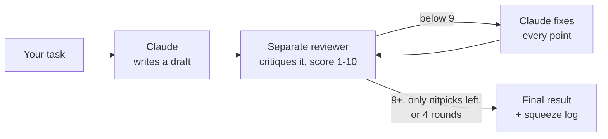
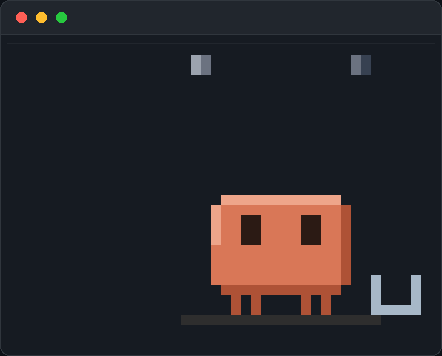
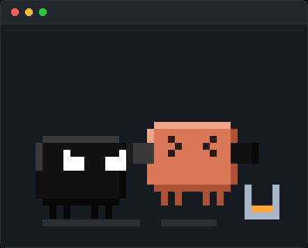
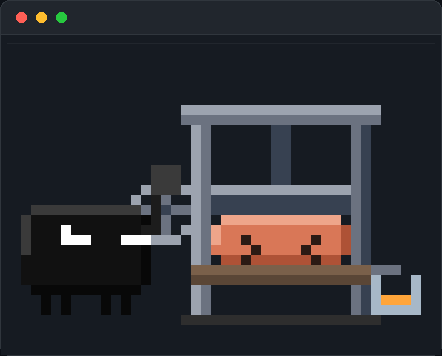

<div align="center">


<br>

**Multi-round self-review for Claude Code.**<br>
A pitch-black persona with angry white eyes grabs Claude's draft and squeezes it,<br>round after round, until nothing weak is left.

<br>

[](#install)
[](LICENSE)
[](#languages)

<sub>Unofficial community plugin. Not made by or affiliated with Anthropic.</sub>

> [!IMPORTANT]
> **It is slow on purpose.** Every round is a full review with real tests, so a run takes many times longer than a normal answer. Fixing a mid-size game took about **35–40 minutes and ~250k tokens**. Use it when you need to be sure your work has no mistakes, not for everyday questions.

[Install](#install) · [How it works](#how-it-works) · [Review mode](#review-mode) · [Fast mode](#fast-mode) · [Compare mode](#compare-mode) · [Ruthless mode](#ruthless-mode) · [Side pane](#the-side-pane) · [Commands](#commands) · [Cost & limits](#cost--limits)

</div>

---

## Install

**Requirements:** Claude Code 2.1.275 or later (built on 2.1.310). The skill works anywhere Claude Code runs; the side pane needs a terminal.

In a Claude Code session:

```
/plugin install ruthless-claude --marketplace mody51510000-code/ruthless-claude
```

Answer `y` to add the marketplace, then pick a scope. If your version doesn't accept `--marketplace`, use the two-step form:

```
/plugin marketplace add mody51510000-code/ruthless-claude
/plugin install ruthless-claude@ruthless-claude
```

The first session after installing prints a short guide once. Run `/ruthless-help` any time to see it again.

## Quick start

```
/ruthless-claude write a function that parses dates like "3 days ago" and "next friday"
```

You get the final result, then a short **squeeze log**. Example output (yours will differ):

```
Round 1 → 5/10 — "next friday" on a Friday returns today, no input validation
Round 2 → 7/10 — fixed both, but ignores time zones
Round 3 → 9/10 — clean

Squeezed him 2 times. That's all he had.
```

## How it works



1. **Claude** does the task and writes a first draft. You don't see it yet.
2. **Ruthless Claude**, a separate reviewer subagent, attacks it: what is wrong, weak, unverified or missing, plus a score out of 10.
3. Claude fixes **every** point and the next round begins.
4. It stops at **9/10**, when only nitpicks are left, or after **4 rounds**, so it never loops forever.

### Proof, not guesses

For code, the reviewer doesn't just read it. It copies the draft into a temporary folder, writes tests for what you asked and for the edge cases it suspects, and runs them. Every finding is tagged:

- **[verified]**: a test that actually fails, with the command and its output
- **[opinion]**: something it couldn't test, and why

Any failing [verified] test caps the score at 6, so a draft can't reach 9/10 while a test still fails. The reviewer's tests are kept and rerun every round, and the squeeze log ends with a line like `12/12 tests pass`.

Tests run **only on temporary copies or sample data**: the skill tells Claude to ask before running anything that would touch your real files.

The scores are still the reviewer model's judgment, not an objective grade. Treat them as a signal, not a guarantee.

## Review mode

Already have code? Squeeze it instead of writing something new:

```
/ruthless-claude review src/parser.ts
/ruthless-claude review              # your uncommitted changes (git diff)
```

Round 1 is your existing work, so the first draft step is skipped. Fixes are made as normal edits that you approve one by one. Add `review only` (or "بس راجع") to get the findings and the score without any edits.

## Fast mode

Short on time, not on tokens? Add `--fast` (or end your request with "بسرعة"):

```
/ruthless-claude write a function that parses relative dates --fast
```

Each round sends **three reviewers at the same time**, each hunting something different: correctness and tests, edge cases and safety, speed and clarity. They find more per round, so it usually finishes in fewer rounds. The round's score is the lowest of the three. Each round costs roughly 2–3× the tokens, and the side pane swaps the squeeze for a press machine.

## Compare mode

Want to see what the squeezing actually changed? Add `--compare`:

```
/ruthless-claude write a function that parses relative dates --compare
```

At the end you get a **Normal Claude vs Ruthless Claude** section:

- **Before:** the untouched first draft (only the changed parts, if it's long)
- **What changed:** each problem in the first draft and how the final version fixes it
- **Cost:** how many rounds ran and roughly how much longer it took

If the first draft was already nearly as good, it says so plainly. Compare mode is **off by default** because it adds output tokens. Ending your request with "show the difference" also works. Words like "compare" inside the task itself ("compare two dates") don't turn it on.

## Ruthless mode

Want the whole terminal to be Ruthless Claude's own app? Turn on Ruthless mode:

```
/ruthless-mode        # on
/ruthless-mode off    # back to normal Claude
```

While it's on:

- **Everything you type is squeezed.** No need to write `/ruthless-claude` each time. Slash commands still run as usual.
- **A bar above the prompt** (`▀▄▀  R U T H L E S S   C L A U D E`) has a button for each switch: `1` Squeeze a task, `2` Review code, `3` Fast, `4` Compare, `5` Pane, `6` Help, `x` Normal Claude.
- **It looks like Ruthless Claude:** black and white, like the character. Your prompts read `▀▄▀ you ›`, Claude's replies get a white bar and a `▀▄▀ RUTHLESS` head, and the spinner says things like *Squeezing* and *Interrogating*.
- **The terminal itself turns black and white:** background, text and cursor, through the standard terminal color codes (Windows Terminal, VS Code, iTerm2, kitty, GNOME Terminal and most others). Red errors and green/red diffs keep their colors. Your terminal gets its own colors back when you turn the mode off or quit Claude. The plugin also ships a **Ruthless** theme for Claude Code, picked automatically; if your version doesn't switch to it, choose it in `/theme`.
- **It stays on** across sessions until you turn it off.

## The side pane

A small pixel-art pane next to the chat shows what's happening:

<table>
<tr>
<td align="center" width="50%"><br><b>Idle</b><br><sub>standing and breathing, now and then a glance</sub></td>
<td align="center" width="50%"><br><b>Claude working</b><br><sub>Claude types at his computer</sub></td>
</tr>
<tr>
<td align="center" width="50%"><br><b>Ruthless Claude active</b><br><sub>grabs Claude and squeezes out the best result</sub></td>
<td align="center" width="50%"><br><b>Fast mode</b><br><sub>drops a press machine on Claude and cranks it hard</sub></td>
</tr>
<tr>
<td align="center" width="50%"><br><b>Claude's revenge</b><br><sub>the first draft scored 9+: Claude breaks free and shoves him off</sub></td>
<td align="center" width="50%"><br><b>Revenge in fast mode</b><br><sub>Claude bursts the press apart and jumps out</sub></td>
</tr>
</table>

**Claude's revenge:** if the first review already scores **9/10 or more**, there's nothing to squeeze, and Claude fights back. In a normal run he puffs up, breaks the grip and shoves Ruthless Claude off the stage. In fast mode he pushes the plate back up, the press machine bursts apart, and he jumps out while Ruthless Claude lands on his backside. Either way Claude ends up standing with the gold gem over his head, and the closing line admits there was nothing to squeeze.

While squeezing, the top of the pane tracks the run: one square per round (up to 4) and a 10-segment score bar that turns red, yellow, then green as the score climbs.

The pane opens by itself at session start when your terminal is wide enough for Claude Code to dock it beside the chat (about 144 columns). In a narrower terminal it may not dock: run `/ruthless-pane` and it tells you whether there was room. Don't want it? `/ruthless-pane off` stops the auto-open (`/ruthless-pane on` brings it back). It never opens in headless runs (`claude -p`, SDK).

## Commands

| Command | What it does |
| --- | --- |
| `/ruthless-claude <task>` | Squeeze the task through review rounds until it scores 9/10 (max 4) |
| `/ruthless-claude <task> --compare` | Same, plus the first draft vs the final one |
| `/ruthless-claude <task> --fast` | 3 reviewers per round at once: fewer rounds, more tokens |
| `/ruthless-claude review [path]` | Squeeze existing code: a file, a folder, or your uncommitted changes |
| `/ruthless-pane` | Open the side pane |
| `/ruthless-pane off` / `on` | Stop / resume opening the pane by itself |
| `/ruthless-help` | Show the guide and all commands |
| `/ruthless-mode` | [Ruthless mode](#ruthless-mode): the terminal becomes Ruthless Claude's own app, and everything you type is squeezed |
| `/ruthless-mode off` | Back to normal Claude (or press `Normal Claude` in the bar) |

If another plugin also has a skill named `ruthless-claude`, use the full name `/ruthless-claude:ruthless-claude`.

Saying **"Ruthless Claude"**, **"ruthless mode"** or **"squeeze it"** in a prompt usually triggers it too. It's up to Claude, so the slash command is the reliable way.

## Cost & limits

- **Tokens:** every round adds a review and a rewrite, so a run costs several times a normal answer (rough estimate: 2–5×, depending on how many rounds run). To keep that down, the reviewer from round 1 stays on: later rounds send it only what changed and it reruns its saved tests, instead of a new reviewer reading everything again. It also skips cache and binary files and keeps findings short. Because a reviewer that stays on can go easy on its own requests, a run of 2+ rounds that reaches 9/10 ends with a **final check**: one new reviewer (same model, never a cheaper one) looks at the changed files with fresh eyes and reruns the tests.
- **Time:** expect minutes, not seconds. A small function takes a few minutes. A real project can take half an hour or more: a review-only pass of a mid-size Godot game took 9–15 minutes, and fixing its bugs through all rounds plus the final check took about 35–40 minutes.
- **Waiting:** you see nothing until the last round is done, so long tasks take a while to come back.
- **When to use it:** only when you want to be sure the work has no mistakes: code you're about to ship, scripts that change files, anything where a bug is costly. For quick questions, small edits or trying ideas, plain Claude is much faster and cheaper.
- **Same model:** the reviewer is another copy of Claude, so both can miss the same mistake. It catches a lot, not everything.

## Languages

Ruthless Claude replies in the language you write in.

<div dir="rtl">

**تنبيه:** الأداة تاخذ وقت، لأن كل جولة مراجعة كاملة مع اختبارات حقيقية. تصليح لعبة متوسطة أخذ حوالي 35 إلى 40 دقيقة. استخدمها بس إذا تبغا تتأكد إن مشروعك ما فيه ولا غلط، وللأسئلة العادية استخدم كلود العادي، أسرع وأرخص.

**بالعربي:** اكتب طلبك بالعربي وبيرد عليك بالعربي. تقدر تقول "كلود القاسي" أو "اعصره"، واكتب "قارن" في آخر الطلب بدل `--compare`، و"بسرعة" بدل `--fast`. ولمراجعة كود موجود اكتب "راجع" (مثلاً: `/ruthless-claude راجع آخر تعديلاتي`).

**الوضع القاسي:** اكتب `/ruthless-mode` والطرفية كلها تصير تطبيق كلود القاسي، أسود وأبيض، وكل شي تكتبه ينعصر. و`/ruthless-mode off` يرجعك لكلود العادي.

</div>

## Uninstall

```
/plugin uninstall ruthless-claude
/plugin marketplace remove ruthless-claude
```

To get a newer version, refresh the marketplace, then open `/plugin` and update the plugin from there:

```
/plugin marketplace update ruthless-claude
```

## Development

```
.claude-plugin/   plugin.json + marketplace.json
skills/           the Ruthless Claude skill (the review loop)
hooks/            the side pane and Ruthless mode: register.tsx (events), art.ts (pixel art), pane.test.tsx
types/            state types for the pane and Ruthless mode
themes/           the Ruthless theme for Claude Code
scripts/          terminal-colors.js: paints the terminal black and white in Ruthless mode
assets/           images for this README
```

Clone the repo, then:

```bash
claude plugin validate .   # check the manifest and hooks module
claude plugin test .       # run the pane and Ruthless mode tests
claude --plugin-dir .      # start a session with your local copy loaded
```

---

<div align="center">
<sub>MIT License · Unofficial community plugin, not made by or affiliated with Anthropic.</sub>
</div>
