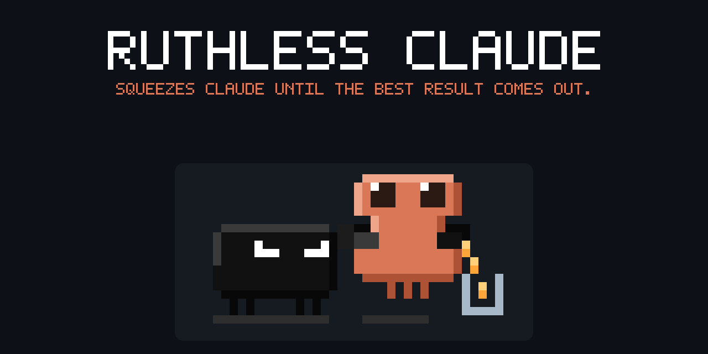
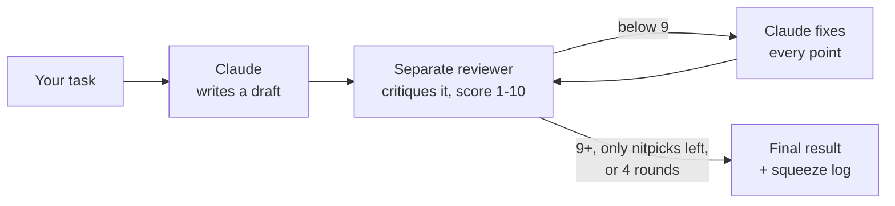
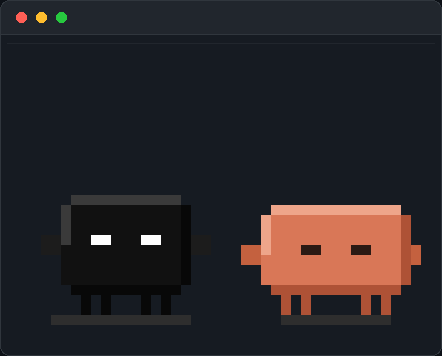
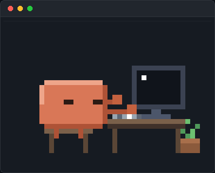
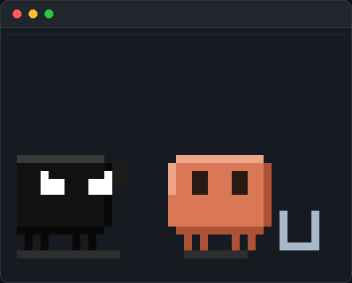

<div align="center">



<br>

**Multi-round self-review for Claude Code.**<br>
A pitch-black persona with angry white eyes grabs Claude's draft and squeezes it,<br>round after round, until nothing weak is left.

<br>

[](#install)
[](LICENSE)
[](#languages)

<sub>Unofficial community plugin. Not made by or affiliated with Anthropic.</sub>

[Install](#install) · [How it works](#how-it-works) · [Compare mode](#compare-mode) · [Side pane](#the-side-pane) · [Commands](#commands) · [Cost & limits](#cost--limits)

</div>

---

## Install

**Requirements:** Claude Code 2.1.275 or later (built on 2.1.310). The skill works anywhere Claude Code runs; the side pane needs a terminal.

In a Claude Code session:

```
/plugin install ruthless-claude --marketplace mody51510000-code/ruthless-claude
```

Answer `y` to add the marketplace, then pick a scope. If your version doesn't accept `--marketplace`, use the two-step form:

```
/plugin marketplace add mody51510000-code/ruthless-claude
/plugin install ruthless-claude@ruthless-claude
```

The first session after installing prints a short guide once. Run `/ruthless-help` any time to see it again.

## Quick start

```
/ruthless-claude write a function that parses dates like "3 days ago" and "next friday"
```

You get the final result, then a short **squeeze log**. Example output (yours will differ):

```
Round 1 → 5/10 — "next friday" on a Friday returns today, no input validation
Round 2 → 7/10 — fixed both, but ignores time zones
Round 3 → 9/10 — clean

Squeezed him 2 times. That's all he had.
```

## How it works



1. **Claude** does the task and writes a first draft. You don't see it yet.
2. **Ruthless Claude**, a separate reviewer subagent, attacks it: what is wrong, weak, unverified or missing, plus a score out of 10.
3. Claude fixes **every** point and the next round begins.
4. It stops at **9/10**, when only nitpicks are left, or after **4 rounds**, so it never loops forever.

For code, it runs or tests the draft between rounds when it can, **only on temporary copies or sample data**: the skill tells Claude to ask before running anything that would touch your real files.

The scores are the reviewer model's judgment, not a test result. Treat them as a signal, not a guarantee.

## Compare mode

Want to see what the squeezing actually changed? Add `--compare`:

```
/ruthless-claude write a function that parses relative dates --compare
```

At the end you get a **Normal Claude vs Ruthless Claude** section:

- **Before:** the untouched first draft (only the changed parts, if it's long)
- **What changed:** each problem in the first draft and how the final version fixes it
- **Cost:** how many rounds ran and roughly how much longer it took

If the first draft was already nearly as good, it says so plainly. Compare mode is **off by default** because it adds output tokens. Ending your request with "show the difference" also works. Words like "compare" inside the task itself ("compare two dates") don't turn it on.

## The side pane

A small pixel-art pane next to the chat shows what's happening:

<table>
<tr>
<td align="center" width="33%"><br><b>Idle</b><br><sub>standing and breathing, now and then a glance</sub></td>
<td align="center" width="33%"><br><b>Claude working</b><br><sub>Claude types at his computer</sub></td>
<td align="center" width="33%"><br><b>Ruthless Claude active</b><br><sub>grabs Claude and squeezes out the best result</sub></td>
</tr>
</table>

The pane opens by itself at session start when your terminal is wide enough for Claude Code to dock it beside the chat (about 144 columns). In a narrower terminal it may not dock: run `/ruthless-pane` and it tells you whether there was room. Don't want it? `/ruthless-pane off` stops the auto-open (`/ruthless-pane on` brings it back). It never opens in headless runs (`claude -p`, SDK).

## Commands

| Command | What it does |
| --- | --- |
| `/ruthless-claude <task>` | Squeeze the task through review rounds until it scores 9/10 (max 4) |
| `/ruthless-claude <task> --compare` | Same, plus the first draft vs the final one |
| `/ruthless-pane` | Open the side pane |
| `/ruthless-pane off` / `on` | Stop / resume opening the pane by itself |
| `/ruthless-help` | Show the guide and all commands |

If another plugin also has a skill named `ruthless-claude`, use the full name `/ruthless-claude:ruthless-claude`.

Saying **"Ruthless Claude"**, **"ruthless mode"** or **"squeeze it"** in a prompt usually triggers it too. It's up to Claude, so the slash command is the reliable way.

## Cost & limits

- **Tokens:** every round adds a full review and a rewrite, so a run costs several times a normal answer (rough estimate: 2–5×, depending on how many rounds run).
- **Waiting:** you see nothing until the last round is done, so long tasks take a while to come back.
- **When to use it:** code, scripts that change files, and anything where a mistake is costly. For quick questions, plain Claude is faster and cheaper.
- **Same model:** the reviewer is another copy of Claude, so both can miss the same mistake. It catches a lot, not everything.

## Languages

Ruthless Claude replies in the language you write in.

<div dir="rtl">

**بالعربي:** اكتب طلبك بالعربي وبيرد عليك بالعربي. تقدر تقول "كلود القاسي" أو "اعصره"، واكتب "قارن" في آخر الطلب بدل `--compare`.

</div>

## Uninstall

```
/plugin uninstall ruthless-claude
/plugin marketplace remove ruthless-claude
```

To get a newer version, refresh the marketplace, then open `/plugin` and update the plugin from there:

```
/plugin marketplace update ruthless-claude
```

## Development

```
.claude-plugin/   plugin.json + marketplace.json
skills/           the Ruthless Claude skill (the review loop)
hooks/            the side pane: register.tsx (events), art.ts (pixel art), pane.test.tsx
types/            state types for the pane
assets/           images for this README
```

Clone the repo, then:

```bash
claude plugin validate .   # check the manifest and hooks module
claude plugin test .       # run the pane tests
claude --plugin-dir .      # start a session with your local copy loaded
```

---

<div align="center">
<sub>MIT License · Unofficial community plugin, not made by or affiliated with Anthropic.</sub>
</div>
