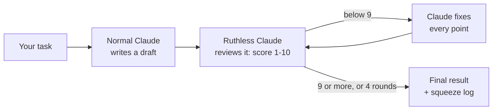

<div align="center">


<br>

**A pitch-black Claude with angry white eyes that grabs normal Claude's work<br>and squeezes it, round after round, until nothing weak is left.**

<br>

[](#install)
[](LICENSE)
[](#languages)

[Install](#install) · [How it works](#how-it-works) · [Compare mode](#compare-mode) · [Side pane](#the-side-pane) · [Commands](#commands)

</div>

---

## Install

In a Claude Code terminal session:

```
/plugin install ruthless-claude --marketplace mody51510000-code/ruthless-claude
```

Answer `y` to add the marketplace, then pick a scope. From a shell instead:

```bash
claude plugin install ruthless-claude --marketplace mody51510000-code/ruthless-claude
```

After installing, the first session prints a short guide in the chat. Run `/ruthless-help` any time to see it again.

## Quick start

```
/ruthless-claude write a script that renames my photos by date
```

You get the final result, then a short **squeeze log**:

```
Round 1 → 5/10 — crashes on an empty folder, no undo
Round 2 → 7/10 — fixed both, but duplicate dates overwrite each other
Round 3 → 9/10 — clean

Squeezed him 3 times. That's all he had.
```

## How it works



1. **Normal Claude** does the task and writes a first draft. You don't see it yet.
2. **Ruthless Claude**, a separate reviewer, attacks it: what is wrong, weak, unverified or missing, and a score out of 10.
3. Claude fixes **every** point and the next round begins.
4. It stops at **9/10**, when only nitpicks are left, or after **4 rounds**, so it never loops forever.

For code, it runs or tests the result between rounds when it can. Claims it can't verify count as weaknesses.

> **When to use it:** code, scripts that change files, and anything where a mistake is costly.
> For quick questions, plain Claude is faster and cheaper. Each round costs extra time and tokens.

## Compare mode

Want to see what the squeezing actually changed? Add `--compare` (or "compare", "show the difference"):

```
/ruthless-claude write a script that renames my photos by date --compare
```

At the end you get a **Normal Claude vs Ruthless Claude** section:

- **Before:** normal Claude's untouched first draft (only the changed parts, if it's long)
- **What changed:** each problem in the first draft and how the final version fixes it
- **Cost:** how many rounds ran and roughly how much longer it took

If the first draft was already nearly as good, it says so plainly. Compare mode is **off by default** because it adds output tokens.

## The side pane

A small pixel-art pane next to the chat shows what's happening:

<table>
<tr>
<td align="center" width="33%"><br><b>Idle</b><br><sub>standing and breathing, now and then a glance</sub></td>
<td align="center" width="33%"><br><b>Normal Claude working</b><br><sub>Claude types at his computer</sub></td>
<td align="center" width="33%"><br><b>Ruthless Claude active</b><br><sub>grabs Claude and squeezes out the best result</sub></td>
</tr>
</table>

The pane opens by itself in terminals 144+ columns wide. In narrower ones run `/ruthless-pane`.

## Commands

| Command | What it does |
| --- | --- |
| `/ruthless-claude <task>` | Squeeze the task through review rounds until it scores 9/10 (max 4) |
| `/ruthless-claude <task> --compare` | Same, plus normal Claude's first draft vs the final one |
| `/ruthless-pane` | Open the side pane |
| `/ruthless-help` | Show the guide and all commands |

You can also just say **"Ruthless Claude"** or **"squeeze it"** in a prompt.

## Languages

Ruthless Claude replies in the language you write in.

<div dir="rtl">

**بالعربي:** اكتب طلبك بالعربي وبيرد عليك بالعربي. تقدر تقول "كلود القاسي" أو "اعصره"، واستخدم "قارن" بدل `--compare`.

</div>

## Project layout

```
.claude-plugin/   plugin.json + marketplace.json
skills/           the Ruthless Claude skill (the review loop)
hooks/            the side pane: register.tsx (events), art.ts (pixel art), tests
types/            state types for the pane
assets/           images for this README
```

---

<div align="center">
<sub>An unofficial community plugin. Not made by or affiliated with Anthropic. · MIT License</sub>
</div>
